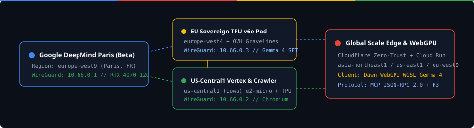

<!-- Copyright 2026 Google LLC. SPDX-License-Identifier: Apache-2.0 -->

# Google DeepMind Carbon (Project Carbon)


**Primary Beta Hub:** `europe-west9` (Paris, France — Google DeepMind Research & Engineering Hub)  
**Global Scale Topology:** `europe-west9` (Paris) &rarr; `europe-west4` (Netherlands Sovereign TPU v6e) &rarr; `us-central1` (Iowa Vertex AI & Chromium Crawler) &rarr; `asia-northeast1` (Tokyo Edge)  
**License:** Apache License 2.0 (`Copyright 2026 Google LLC`)



---

## 1. Executive Vision & Architecture

**Project Carbon** is a polyglot, zero-copy AI control plane, Gemini Web App & OpenAI `/v1` Gateway, knowledge graph engine, and hybrid inference/training platform engineered on three tightly coupled execution planes:

1. **Bare-Metal Rust 2024 Tensor & RAG Kernel Plane (`crates/carbon_ffi`)**:
   - Compiled to native shared machine code (`carbon_ffi.dll` / `.so`) with `lto = "fat"`, `codegen-units = 1`, `panic = "unwind"`, `opt-level = 3`.
   - Exports 9 C ABI symbols (`#[unsafe(no_mangle)]`) consumed zero-copy by both Upstream Bun (`bun:ffi` `ptr(Float32Array)`) and Python (`ctypes`):
     - `carbon_engine_version` (`"4.0.0-deepmind-paris-argon"`)
     - `carbon_dot_product` (8-way unrolled SIMD f32 dot product)
     - `carbon_cosine_similarity` (Zero-copy vector RAG similarity scoring)
     - `carbon_softmax_inplace` (Numerically stable temperature-scaled softmax)
     - `carbon_rmsnorm_gemma` (Gemma's signature `x * (1.0 + weight) * rsqrt(mean(x^2) + eps)` unit-offset RMSNorm)
     - `carbon_geglu_mlp` (Gemma's Tanh-approximated GeGLU activation `gelu_tanh(gate) * up`)
     - `carbon_rope_inplace` (Rotary Positional Embedding over multi-head Q/K tensors)
     - `carbon_matvec_f32` (Dense linear projection `y = W * x`)
     - `carbon_gemma_layer_step` (Fused single-call Gemma 4 pre-norm GeGLU residual block)

2. **Upstream Bun v1.4.4+ Host, Gemini Web Gateway, WebGPU & MCP Plane (`packages/*`, `src/main.ts`)**:
   - `@carbon/core`: Shared schemas, live upstream census (`.yolo/upstream-source-of-truth.json`), and `bun:ffi` bindings.
   - `@carbon/gemini-web-client`: Gemini Web App (`gemini.google.com`) client (`__Secure-1PSID` / `__Secure-1PSIDTS` cookie vault, `RotateCookies` daemon, `WIZ_global_data` `SNlM0e` XSRF scraper, `BardFrontendService/StreamGenerate` RPC builder), 17 `@Extension` & core capabilities (`deep_research`, `canvas`, `gems`, `saved_info`, `@GitHub`, `@Google Workspace`, etc.), OpenAI-compatible Gateway (`GET /v1/models`, `POST /v1/chat/completions`), and global benchmark catalog (LMSYS Chatbot Arena, OpenRouter, Hugging Face, Vertex AI, LiteLLM, Open WebUI).
   - `@carbon/design-crawler`: Autonomous crawler and local mirror (`mirror/design.google/`) for `https://design.google/` and `https://design.google/library/evolving-google-identity`, extracting official Google 4-color tokens (`#4285F4`, `#EA4335`, `#FBBC04`, `#34A853`), HCT dark surfaces, and Google Sans typography scales.
   - `@carbon/graph-engine`: Deterministic AST & `Cargo.toml` dependency graph over Upstream Bun v1.4.4 (`1,297` nodes, `1,222` edges, `134` Cargo workspace crates, `117` `src/*` subsystems).
   - `@carbon/dataset`: Recursive Upstream Bun source harvester and 64-dim n-gram vector RAG ranker powered by Rust `carbon_cosine_similarity`.
   - `@carbon/webgpu-gemma`: Dawn WebGPU WGSL compute shaders (`GEMMA_WGSL_MATMUL`, `GEMMA_WGSL_RMSNORM`, `GEMMA_WGSL_GEGLU`, `GEMMA_WGSL_ROPE`) + bare-metal Rust hybrid forward pass.
   - `@carbon/mesh-cluster`: Unified WireGuard (`10.66.0.0/24`) & Google Cloud multi-region topology orchestrator.
   - `@carbon/mcp-server`: Full JSON-RPC 2.0 Model Context Protocol (MCP) server exposing 9 tools (including carbon_yolo_web_vault_sync) and 4 resources to Gemini Web, AGY, and IDE agents.
   - `@carbon/cli` & `@carbon/web`: Unified CLI and Google DeepMind dark-mode Web Control Plane (`:4040`), compiled into a single standalone AoT binary (`bin/carbon.exe`).

3. **Astral `uv` Python 3.11+ ML, Gemini Web & Fine-Tuning Plane (`python/*`)**:
   - `carbon-core`: Python `ctypes` bindings to all 9 Rust `carbon_ffi` kernels.
   - `carbon-gemini-web`: Python Gemini Web App client (`SNlM0e` extractor, `StreamGenerate` RPC payload builder, `__Secure-1PSID` cookie vault, and `/v1/chat/completions` client).
   - `gemma-train`: Gemma 4 E2B QLoRA & Tunix post-training pipeline targeting Local NVIDIA RTX 4070 (12GB CUDA 13.4) and Vertex AI TPU v6e (`europe-west4`) with live Rust FFI layer-step verification.
   - `carbon-graph`: Python query interface over the 1,297-node Upstream Bun architecture graph.
   - `carbon-cli` & `carbon-web`: Python CLI (`carbon-py`) and JSON API service (`:4041`).

---

## 2. Repository Layout

```text
C:\src\carbon
├── assets/brand/                # Official Google DeepMind & Paris Topology SVG vectors
├── bin/carbon.exe               # Standalone Ahead-of-Time (AoT) compiled binary
├── crates/carbon_ffi/           # Rust 2024 cdylib/rlib (9 Gemma 4 & RAG C ABI kernels)
├── docs/                        # Architecture, Code Review & Upstream Knowledge manuals
├── graphify-out/                # Tree-Sitter AST Knowledge Graph (graphify update .)
├── infra/
│   ├── gateway/                 # LiteLLM Proxy (litellm-config.yaml) & Open WebUI configs
│   ├── gcp/                     # Cloud Build, Cloud Run (europe-west9) & Vertex AI TPU jobs
│   └── wireguard/               # Unified 10.66.0.0/24 Rack Mesh configuration
├── mirror/design.google/        # Local mirror of design.google & evolving-google-identity
├── packages/
│   ├── core/                    # @carbon/core: Types, Upstream Census & bun:ffi bindings
│   ├── gemini-web-client/       # @carbon/gemini-web-client: StreamGenerate, Cookies, /v1 Gateway
│   ├── design-crawler/          # @carbon/design-crawler: design.google crawler & Brand Tokens
│   ├── dataset/                 # @carbon/dataset: Bun code harvester & Rust RAG ranker
│   ├── graph-engine/            # @carbon/graph-engine: 1,297-node Bun crate/subsystem graph
│   ├── webgpu-gemma/            # @carbon/webgpu-gemma: WGSL shaders & Gemma 4 forward step
│   ├── mesh-cluster/            # @carbon/mesh-cluster: Paris -> Global multi-region mesh
│   ├── mcp-server/              # @carbon/mcp-server: JSON-RPC 2.0 MCP server (9 tools)
│   ├── cli/                     # @carbon/cli: Full CLI command suite
│   └── web/                     # @carbon/web: Google DeepMind UI/UX & HTTP/MCP/OpenAI server (:4040)
├── python/
│   ├── carbon_core/             # Python ctypes bindings to crates/carbon_ffi
│   ├── carbon_gemini_web/       # Python Gemini Web App client & OpenAI /v1 bridge
│   ├── carbon_graph/            # Python Bun architecture graph inspector
│   ├── gemma_train/             # Gemma 4 E2B QLoRA / Tunix trainer & FFI verifier
│   ├── carbon_cli/              # Python CLI (carbon-py)
│   └── carbon_web/              # Python HTTP JSON server (:4041)
├── src/main.ts                  # Unified AoT binary entrypoint
└── tests/carbon.test.ts         # 15-test / 53-assertion Bun test suite
```

---

## 3. Quick Start & Verification Commands

### Rust Bare-Metal Kernel Compilation & Tests

```bash
cargo test --manifest-path crates/carbon_ffi/Cargo.toml
cargo build --release --manifest-path crates/carbon_ffi/Cargo.toml
```

### Upstream Bun v1.4.4+ Monorepo & Standalone AoT Binary

```bash
bun test                         # Run 15 unit & integration tests (53 assertions)
bun run check                    # TypeScript 7 (tsgo) typecheck across all workspaces
bun run lint                     # Zero-warning lint check
bun run fmt                      # Format all TS/JSON/MD/TOML files

# CLI Commands
bun run cli:status               # Paris (europe-west9) Beta -> Global status & census
bun run cli:gemini-web           # Gemini Web App endpoints, 17 tools, /saved-info & /v1 Gateway
bun run cli:benchmarks           # LMSYS Arena, OpenRouter, HF, Vertex AI & client ecosystem
bun run cli:crawl-design         # Mirror design.google & evolving-google-identity locally
bun run cli:bench                # 1,000,000 f32 SIMD Dot Product & Cosine Similarity
bun run cli:gemma                # Execute Gemma 4 E2B Transformer Layer Step via Rust FFI
bun run cli:graph aot            # Query Upstream Bun 1,297-node Knowledge Graph
bun run cli:mesh                 # Inspect 7-node Unified WireGuard & Cloud Run Mesh
bun run cli:mcp                  # List Model Context Protocol (MCP) tools (8 tools)

# Recompile Standalone AoT Binary
bun run compile:aot
./bin/carbon.exe status
./bin/carbon.exe gemini-web
./bin/carbon.exe benchmarks
```

### Astral `uv` Python Monorepo

```bash
uv sync
uv run ruff check python
uv run --package carbon-cli carbon-py status
uv run --package carbon-gemini-web carbon-gemini-web-py
uv run --package gemma-train gemma-train-py
uv run --package carbon-graph carbon-graph-py
```

---

## 4. License

Copyright 2026 Google LLC. Licensed under the [Apache License, Version 2.0](./LICENSE).
